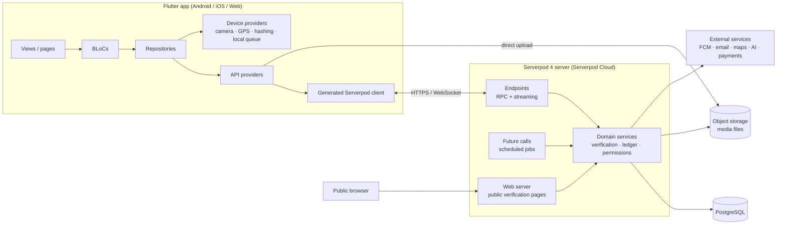
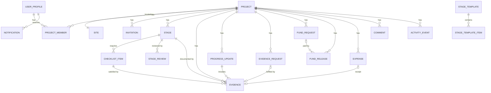
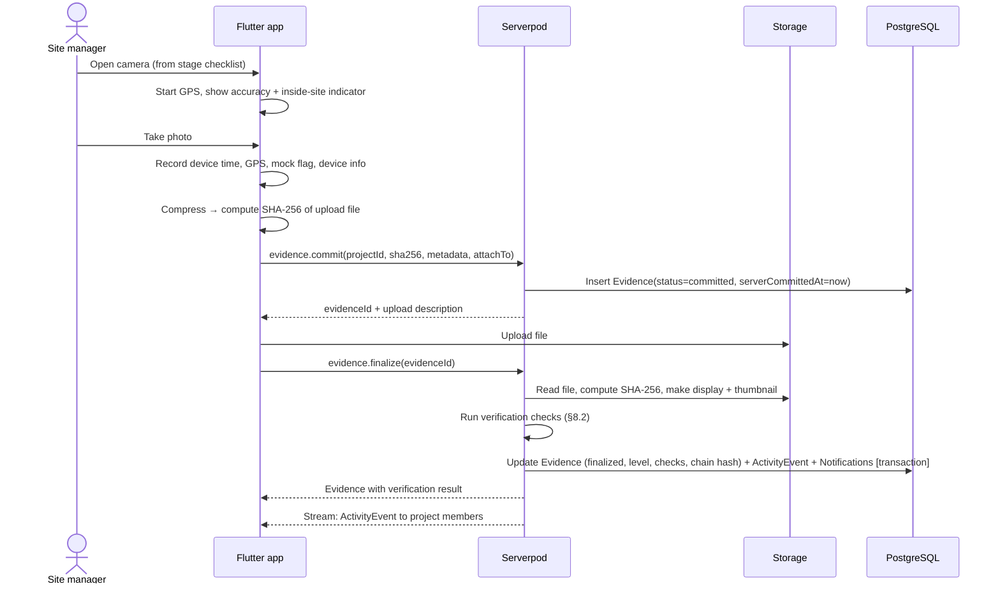
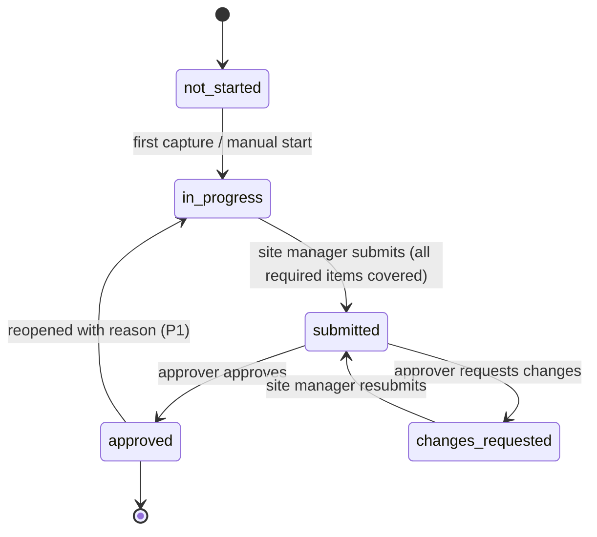
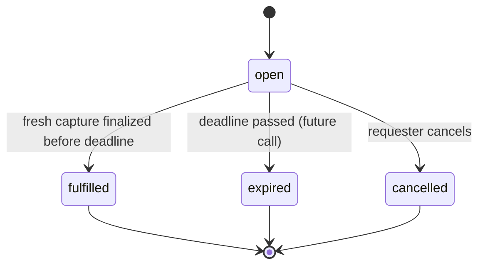
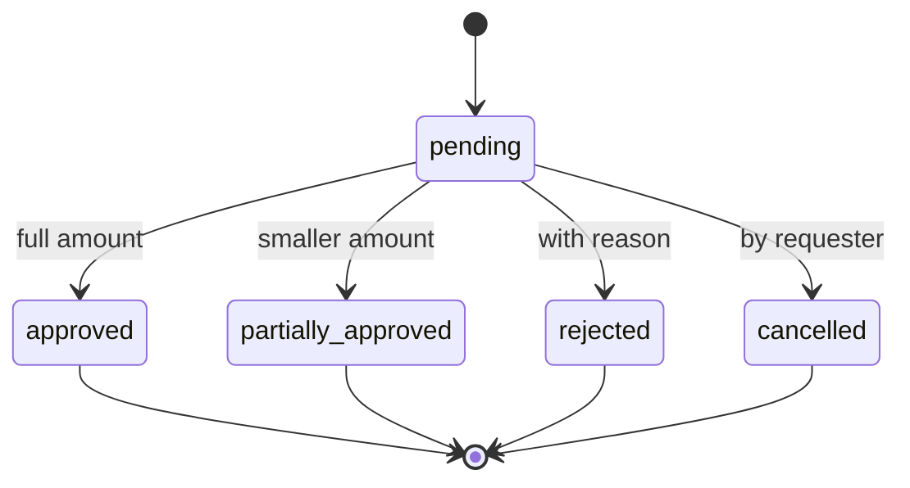
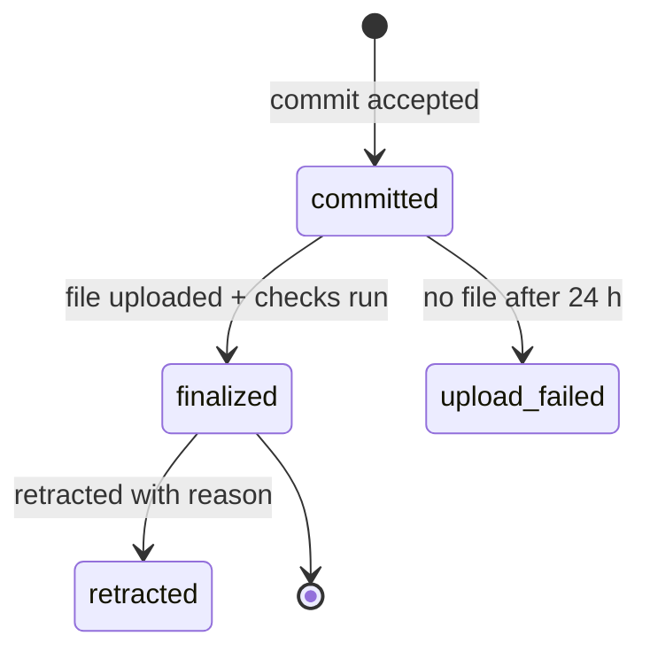

# Requirements Specification

> **Status:** Draft v0.1, awaiting review
> **Date:** 2026-10-03
> **Product name:** **Plotwatch** (chosen 2026-10-04). "The platform" in this document means Plotwatch.
> **Related documents:** [01-project-overview.md](01-project-overview.md) · [03-mvp-scope.md](03-mvp-scope.md) · [00-project-context.md](00-project-context.md)

---

## Table of contents
1. [Introduction](#1-introduction)
2. [Overall description](#2-overall-description)
3. [Roles and permissions](#3-roles-and-permissions)
4. [Functional requirements](#4-functional-requirements)
5. [Non-functional requirements](#5-non-functional-requirements)
6. [System architecture](#6-system-architecture)
7. [Data model](#7-data-model)
8. [Verification engine (detailed design)](#8-verification-engine-detailed-design)
9. [Key flows](#9-key-flows)
10. [State machines](#10-state-machines)
11. [Open questions](#11-open-questions)
12. [Appendix](#12-appendix)

---

## 1. Introduction

### 1.1 Purpose
This document describes **everything the platform should eventually do**. It covers the functional and non-functional requirements and how the system is split into frontend, backend, database, storage and external services. It is the reference for design and implementation. The hackathon MVP is a subset of it, defined in [03-mvp-scope.md](03-mvp-scope.md).

### 1.2 Scope
Plotwatch lets a **funder** oversee a construction project carried out by a **site manager** in another location. It does this through verified evidence capture, stage-based reviews and a shared financial ledger. Later phases add inspectors, payments, AI assistance, organizations and maintenance after completion.

### 1.3 Requirement conventions
Each requirement has an **ID**, a **description** and a **phase**:

| Phase | Meaning |
|-------|---------|
| `MVP` | Must be in the hackathon build |
| `MVP-S` | *Should* be in the hackathon build if time allows (planned, but cut first) |
| `MVP-X` | Stretch goal for the hackathon; only if everything else is done |
| `P1` | Phase 1: pilot with real users |
| `P2` | Phase 2: trust features (attestation, inspectors, AI) |
| `P3` | Phase 3: money (payments, escrow, contracts, disputes) |
| `P4` | Phase 4: lifecycle and scale (organizations, maintenance, API) |

ID prefixes match the module, e.g. `CAP-03` is requirement 3 of the Verified Capture module.

### 1.4 Definitions
| Term | Definition |
|------|------------|
| **Funder** | The person or organization paying for the build. Owns the project. |
| **Site manager** | The person on site who documents progress. Could be a contractor, foreman or relative. |
| **Site** | The physical plot, defined by a centre point and a radius (later also a polygon). |
| **Stage** | A milestone of the build (e.g. "Foundation") with a budget, planned dates and an evidence checklist. |
| **Checklist item** | One piece of evidence a stage requires (e.g. "Photo of foundation trench, all four corners"). |
| **Evidence / capture** | A photo (later video/audio) taken through the in-app camera, with verification metadata. |
| **Verification level** | The trust result for a capture: `verified`, `partially_verified` or `unverified`. |
| **Commit** | The first, lightweight step of a capture upload. The client sends the file hash and metadata; the server records its own timestamp. |
| **Evidence request** | A funder's on-demand request for a fresh capture before a deadline (a spot check). |
| **Fund request** | A site manager's request for money, with a justification. |
| **Fund release** | A record that the funder sent money (outside the platform in the MVP). |
| **Expense** | A record of money spent on site, ideally with a receipt capture. |
| **Unaccounted balance** | Money released minus expenses backed by evidence. The key early-warning number. |
| **Minor units** | Money stored as an integer in the currency's smallest unit (e.g. cents) to avoid rounding errors. |

---

## 2. Overall description

### 2.1 Product perspective
A new, standalone product made of:
- **A Flutter client app** with a single codebase for Android, iOS and web. Each user's role on a project decides what they see.
- **A Serverpod backend** offering typed endpoints, streaming, scheduled jobs, file storage and a small public web server.
- **A PostgreSQL database** accessed through the Serverpod ORM.
- **Object storage** for media files.
- **External services** in later phases: push notifications, email, maps, payments, AI, device attestation.

### 2.2 User classes
| Class | Technical skill | Typical device | Typical connectivity |
|-------|-----------------|----------------|----------------------|
| Funder | Medium to high | Smartphone and/or laptop | Good (often abroad or in a city) |
| Co-funder / viewer | Varies | Smartphone | Good |
| Site manager | Low to medium | Low- to mid-range Android phone | Poor or intermittent on site |
| Inspector *(P2)* | Medium to high | Smartphone | Varies |
| Organization admin *(P4)* | Medium to high | Laptop (web) | Good |
| Platform admin | High | Laptop (web) | Good |

### 2.3 Operating environment
- **Android:** minimum version to be confirmed (target Android 8.0 / API 26 or higher). This is the main platform for site managers.
- **iOS:** current and previous major versions.
- **Web:** recent versions of Chrome, Edge, Safari and Firefox. Mainly for funders; capturing evidence is **not** allowed on web.
- **Backend:** Serverpod 4 on Serverpod Cloud.

### 2.4 Constraints
- C-1: The hackathon build must be a **new, original** project using Flutter and Serverpod, submitted before **2026-10-14**.
- C-2: **No real money movement** before Phase 3. Moving money requires licensed payment partners and regulatory compliance.
- C-3: Evidence capture is mobile-only (camera and GPS hardware).
- C-4: Media must be usable on slow mobile networks (compression, resumable uploads).
- C-5: Personal data (location, faces in photos, financial records) is subject to privacy law, including GDPR for funders in the EU.

### 2.5 Assumptions (to validate with real users)
- A-1: Site managers have an Android smartphone with a working camera and GPS, and occasional mobile data.
- A-2: Funders prefer releasing money stage by stage over one large advance.
- A-3: Site managers will accept verified capture if it is presented as protection and faster payment for them.
- A-4: A centre point plus a radius is accurate enough to define most plots for an MVP.
- A-5: Funders want to record payments made outside the platform (bank transfer, mobile money, cash) before integrated payments exist.
- A-6: English and French cover the first pilot users.

### 2.6 Dependencies
- Serverpod 4 framework, auth module, file storage and Serverpod Cloud.
- Flutter camera and location plugins, plus a cryptographic hash library (SHA-256).
- Maps provider (Google Maps or OpenStreetMap) for choosing the site. An Open Location Code (Plus Code) library to enter the location by code.
- FCM / APNs for push notifications (P1).
- Transactional email provider for invitations and account emails.

---

## 3. Roles and permissions

### 3.1 Project-level roles
A user can hold different roles on different projects (a site manager on one project may be the funder on another).

| Role | Description |
|------|-------------|
| `owner` | Funder who created the project. Exactly one per project. Full control. |
| `co_funder` | Funder with optional approval rights (`can_approve` flag). |
| `viewer` | Read-only access (family, donors). |
| `site_manager` | Documents progress, logs expenses, requests funds. One or more per project. |
| `inspector` *(P2)* | Independent verifier with access limited to the inspections assigned to them. |

### 3.2 Permission matrix
✅ = allowed · ⚪ = allowed if `can_approve` · ❌ = not allowed

| Action | owner | co_funder | viewer | site_manager |
|--------|:-----:|:---------:|:------:|:------------:|
| View project, stages, evidence, ledger | ✅ | ✅ | ✅ | ✅ |
| Edit project details, currency; validate or reject the site location | ✅ | ❌ | ❌ | ❌ |
| Propose the site location (GPS on the plot, SITE-04) | ❌ | ❌ | ❌ | ✅ |
| Archive / delete project | ✅ | ❌ | ❌ | ❌ |
| Invite / remove members | ✅ | ❌ | ❌ | ❌ |
| Create / edit / reorder stages | ✅ | ❌ | ❌ | ❌ *(may propose, P1)* |
| Capture evidence | ❌ | ❌ | ❌ | ✅ |
| Post progress updates | ❌ | ❌ | ❌ | ✅ |
| Submit stage for review | ❌ | ❌ | ❌ | ✅ |
| Approve stage / request changes | ✅ | ⚪ | ❌ | ❌ |
| Create evidence requests | ✅ | ⚪ | ❌ | ❌ |
| Fulfil evidence requests | ❌ | ❌ | ❌ | ✅ |
| Create fund requests | ❌ | ❌ | ❌ | ✅ |
| Decide fund requests | ✅ | ⚪ | ❌ | ❌ |
| Record fund releases | ✅ | ⚪ | ❌ | ❌ |
| Confirm receipt of funds | ❌ | ❌ | ❌ | ✅ |
| Record expenses | ❌ | ❌ | ❌ | ✅ |
| Comment | ✅ | ✅ | ❌ *(P1: configurable)* | ✅ |
| Create public share links | ✅ | ⚪ | ❌ | ❌ |

**Rule:** the backend enforces every permission. Hiding buttons in the client is never the only protection.

---

## 4. Functional requirements

### 4.1 Accounts and authentication (AUTH)
| ID | Requirement | Phase |
|----|-------------|-------|
| AUTH-01 | Users can sign up and sign in with email and password, using the Serverpod auth module. | MVP |
| AUTH-02 | Email is verified with a code or link before the account is fully active. | MVP |
| AUTH-03 | Users can reset a forgotten password by email. | MVP |
| AUTH-04 | Users can sign in with Google. | MVP-S |
| AUTH-05 | Users can sign in with Apple (required for the iOS App Store if other social logins exist). | P1 |
| AUTH-06 | Users can sign in with phone number + OTP (important for site managers without email). | P1 |
| AUTH-07 | The session persists across app restarts until sign-out or expiry. | MVP |
| AUTH-08 | Users can sign out on the current device. | MVP |
| AUTH-09 | Users can see and revoke active sessions and devices. | P2 |
| AUTH-10 | Users can delete their account, with data handled per the retention policy (§5.8). | P1 |
| AUTH-11 | Optional two-factor authentication for funders. | P2 |

### 4.2 User profile and settings (PROF)
| ID | Requirement | Phase |
|----|-------------|-------|
| PROF-01 | Users have a profile: full name, optional photo, optional phone, country. | MVP |
| PROF-02 | Users can choose the app language (English / French); the device language is the default. | MVP |
| PROF-03 | Users can edit their profile. | MVP |
| PROF-04 | Users can set a time zone for displaying dates (defaults to the device's). | P1 |
| PROF-05 | Users can choose which notifications they receive, per type. | P1 |
| PROF-06 | Users can choose light or dark theme. | P1 |

### 4.3 Projects (PROJ)
| ID | Requirement | Phase |
|----|-------------|-------|
| PROJ-01 | A funder can create a project with name, description, project type (new house, extension, renovation, community building, other), currency and target dates. | MVP |
| PROJ-02 | The creator becomes the project `owner`. | MVP |
| PROJ-03 | Users see a list of all projects they belong to, with their role, status and progress for each. | MVP |
| PROJ-04 | The owner can edit project details. Currency can't change once money has been recorded. | MVP |
| PROJ-05 | Project status: `draft` → `active` → `paused` / `completed` → `archived`. | MVP |
| PROJ-06 | The owner can archive a project; archived projects are read-only. | P1 |
| PROJ-07 | The owner can upload a cover image. | P1 |
| PROJ-08 | Project creation is a guided step-by-step wizard (details → site → stages → review). | MVP |
| PROJ-09 | The owner can transfer ownership to another member. | P2 |
| PROJ-10 | The owner can duplicate a project's stage plan into a new project. | P2 |

### 4.4 Site and location (SITE)
| ID | Requirement | Phase |
|----|-------------|-------|
| SITE-01 | The owner can set the site's centre by dropping a pin on a map. | P1 (revised 2026-10-06, `04b` M2-15) |
| SITE-02 | The owner can set the site's centre by entering a Plus Code (Open Location Code), full or short with a locality. | P1 (revised 2026-10-06, `04b` M2-15) |
| SITE-03 | The owner sets the site's radius in metres when validating the location (default 50 m, range 10–500 m). The radius is drawn on the map. | MVP |
| SITE-04 | A site manager standing on the plot proposes the site's centre from their current GPS position (accuracy 20 m or better; mocked positions refused). The owner validates or rejects the proposal; the first validation activates the project. This is the way the site is set. | MVP (revised 2026-10-06, `04b` M2-15) |
| SITE-05 | The owner can draw a polygon boundary instead of a radius. | P2 |
| SITE-06 | The site stores an optional address/description (MVP) and the plot's time zone (P1, `04b` M2-10). | MVP |
| SITE-07 | Every change to the site location is recorded in the audit log and shown in the activity feed, because moving the site would change which captures pass the location check. | MVP |
| SITE-08 | Reference "photo points": fixed positions on site, re-photographed over time from the same angle, with an on-screen guide (see CMP). | P2 |

### 4.5 Membership and invitations (MEMB)
| ID | Requirement | Phase |
|----|-------------|-------|
| MEMB-01 | The owner can create an invitation for a role (`site_manager`, `co_funder`, `viewer`). It produces a short code and a shareable deep link. | MVP |
| MEMB-02 | Invitations expire (default 7 days) and can be used once. | MVP |
| MEMB-03 | A signed-in user can join a project by entering the code or opening the link. If not signed in, they are taken through sign-up first and then joined. | MVP |
| MEMB-04 | The owner sees the list of members with role and join date, and can remove a member. | MVP |
| MEMB-05 | The owner can cancel pending invitations. | MVP |
| MEMB-06 | Invitations can be sent directly by email or SMS from the app. | P1 |
| MEMB-07 | The owner can change a member's role and set `can_approve` for co-funders. | P1 |
| MEMB-08 | A removed member loses access immediately, including to their active streams. | MVP |

### 4.6 Stages and templates (STG)
| ID | Requirement | Phase |
|----|-------------|-------|
| STG-01 | The owner can create stages with: name, description, order, budget (minor units), planned start date and planned end date. | MVP |
| STG-02 | The owner can edit, reorder and delete stages that haven't been submitted for review yet. | MVP |
| STG-03 | The owner can start from a built-in template (e.g. "Single-storey house", "Renovation") and edit the result. | MVP |
| STG-04 | Each stage has a checklist of required evidence items (label, required yes/no). | MVP |
| STG-05 | Stage status follows the state machine in §10.1 (`not_started`, `in_progress`, `submitted`, `changes_requested`, `approved`). | MVP |
| STG-06 | A stage moves to `in_progress` automatically when its first evidence is captured, or manually by the site manager. | MVP |
| STG-07 | The site manager can submit a stage once every *required* checklist item has at least one capture attached. | MVP |
| STG-08 | Each stage shows its progress: checklist items completed out of total. | MVP |
| STG-09 | Overall project progress = budget-weighted share of approved stages. | MVP |
| STG-10 | Stages show schedule status: on time / late (past the planned end date and not approved). | MVP-S |
| STG-11 | Site managers can propose new stages or changes; the owner accepts or rejects them. | P1 |
| STG-12 | Stage dependencies and a Gantt-style timeline. | P2 |
| STG-13 | Users can save their own stage plans as personal templates. | P2 |
| STG-14 | Checklist items can say which evidence type they need (photo / video / document). | P1 |

### 4.7 Budget and bill of quantities (BUD)
| ID | Requirement | Phase |
|----|-------------|-------|
| BUD-01 | The project budget is the sum of its stage budgets, shown in the project currency. | MVP |
| BUD-02 | All amounts are stored as integers in minor units, together with an ISO 4217 currency code. | MVP |
| BUD-03 | Each stage can have budget lines (item, quantity, unit, unit cost); the stage budget can be calculated from them. | P1 |
| BUD-04 | Change orders: changing the budget of a stage already in progress needs a reason and is logged. | P1 |
| BUD-05 | Amounts can be shown converted to a second currency for the funder (rate source to be decided). | P2 |
| BUD-06 | Benchmark material prices for a region, to flag inflated expenses. | P2 |

### 4.8 Verified capture (CAP)
| ID | Requirement | Phase |
|----|-------------|-------|
| CAP-01 | Evidence can only be captured with the in-app camera. Choosing from the gallery is **not** possible. | MVP |
| CAP-02 | The camera screen shows live GPS status: accuracy in metres, and whether the user is inside the site boundary. | MVP |
| CAP-03 | When a capture is taken, the client records: device timestamp, GPS latitude/longitude/accuracy/altitude, the mock-location flag (Android), device model, OS version and app version. | MVP |
| CAP-04 | Immediately after capture (and compression, see CAP-08), the client computes the SHA-256 hash of the exact file that will be uploaded. The capture is never written anywhere the user can modify before hashing. | MVP |
| CAP-05 | Upload has two steps: (1) **commit**, sending the hash and metadata, which gets a server timestamp and a capture ID; (2) **upload** of the file, after which the server checks the hash (see §9.1). | MVP |
| CAP-06 | Before submitting, the user can attach the capture to a stage and checklist item and add a caption. | MVP |
| CAP-07 | The uploaded file is stored unchanged (it is what the hash covers). A display version and a thumbnail are generated from it for viewing. | MVP |
| CAP-08 | The client compresses photos to a configurable size or quality before hashing and upload, so the committed hash matches the bytes stored on the server. *(See open question Q6.)* | MVP |
| CAP-09 | Captures can't be edited after commit. They can only be retracted (soft delete) with a reason, which stays visible in the audit log. | MVP |
| CAP-10 | Captures taken while offline are queued on the device with their device timestamp and committed automatically when back online (see OFF). | MVP-X |
| CAP-11 | Short video capture (≤ 60 s) with the same verification metadata. | P1 |
| CAP-12 | Voice notes attached to captures or updates. | P1 |
| CAP-13 | Compass heading recorded with each capture. | P1 |
| CAP-14 | Device integrity attestation (Play Integrity API / App Attest) attached to the commit. | P2 |
| CAP-15 | C2PA content credentials embedded in exported media. | P2 |
| CAP-16 | Resumable uploads for large files. | P1 |

### 4.9 Verification engine (VER)
| ID | Requirement | Phase |
|----|-------------|-------|
| VER-01 | After upload, the server runs verification checks (defined in §8.2) and stores each check's result together with an overall level. | MVP |
| VER-02 | Overall level: `verified` (every check passed), `partially_verified` (only non-critical checks failed), `unverified` (any critical check failed). | MVP |
| VER-03 | Every capture shows a verification badge. Tapping it shows each check with a plain-language explanation (e.g. "Taken 12 m from the site centre ✓"). | MVP |
| VER-04 | The server rejects a finalize step if the uploaded file's hash doesn't match the committed hash. The capture is marked `unverified` with reason `hash_mismatch`. | MVP |
| VER-05 | Each finalized capture is added to a per-project hash chain (each record contains the hash of the previous record), so tampering with history can be detected. | MVP-S |
| VER-06 | The server signs each capture record with a platform key (Ed25519). The public key is published so anyone can check a signature. | MVP-X |
| VER-07 | Near-duplicate detection: a perceptual hash is compared against the project's earlier captures; reused or near-identical photos are flagged. | P1 |
| VER-08 | Device attestation result included as a check. | P2 |
| VER-09 | Verification thresholds (GPS accuracy, time tolerance, upload delay) can be configured per project within limits set by the platform. | P2 |
| VER-10 | The app clearly states that verification proves **where and when** a capture was taken, **not** the quality of the construction. | MVP |

### 4.10 Progress updates / site diary (UPD)
| ID | Requirement | Phase |
|----|-------------|-------|
| UPD-01 | The site manager can post a progress update: text, one or more captures, an optional stage, and optional fields (number of workers, weather, issues/blockers). | MVP |
| UPD-02 | Updates appear in the project activity feed in real time for all members. | MVP |
| UPD-03 | Updates can't be edited after 15 minutes; corrections are posted as new updates. | P1 |
| UPD-04 | Daily site diary view: updates grouped by day. | P1 |
| UPD-05 | Reminder if no update has been posted for N days (configurable, default 7). | MVP-S |

### 4.11 Evidence requests / spot checks (REQ)
| ID | Requirement | Phase |
|----|-------------|-------|
| REQ-01 | A funder (owner, or co-funder with approval rights) can create an evidence request: instructions, optional stage, deadline (presets: 30 min, 2 h, 24 h, custom). | MVP-S |
| REQ-02 | Site managers are notified immediately: in-app in real time, and by push from P1. | MVP-S |
| REQ-03 | The site manager fulfils the request with a fresh verified capture taken *after* the request was created. Earlier captures can't be used. | MVP-S |
| REQ-04 | When the deadline passes, a scheduled job (Serverpod future call) marks the request `expired` and notifies the funder. | MVP-S |
| REQ-05 | Request history shows: on time, late or missed, with response times. This builds a reliability record. | P1 |
| REQ-06 | Automatic random spot checks at a frequency the funder sets. | P2 |
| REQ-07 | Live video call between funder and site manager, started from a request. | P2 |

### 4.12 Stage review and approval (REV)
| ID | Requirement | Phase |
|----|-------------|-------|
| REV-01 | When a stage is submitted, all approvers are notified. | MVP |
| REV-02 | The review screen shows the stage checklist, the captures for each item with verification badges, the stage budget, and the money released and spent for that stage. | MVP |
| REV-03 | An approver can **approve** the stage, or **request changes** with a required comment. | MVP |
| REV-04 | When changes are requested, the stage goes back to `changes_requested`. The site manager adds evidence and submits again. | MVP |
| REV-05 | Every review decision is permanent and visible in the stage history. | MVP |
| REV-06 | After approving, the funder is offered "record a fund release for the next stage" (links REV → LED). | MVP-S |
| REV-07 | Approval rules: e.g. require 2 approvers, or an inspector's sign-off, for certain stages. | P2 |
| REV-08 | An approval can be reopened, with a reason, if a problem is found later. | P1 |

### 4.13 Fund requests (FREQ)
| ID | Requirement | Phase |
|----|-------------|-------|
| FREQ-01 | The site manager can create a fund request: amount, optional stage, reason, and an optional list of items. | MVP-S |
| FREQ-02 | A funder can approve (full or partial amount), reject (with reason) or leave the request pending. | MVP-S |
| FREQ-03 | Approving a fund request offers to record the matching fund release. | MVP-S |
| FREQ-04 | Fund requests show in the ledger with their status. | MVP-S |
| FREQ-05 | Reminder to funders about requests left pending for more than N days. | P1 |

### 4.14 Ledger: releases and expenses (LED)
| ID | Requirement | Phase |
|----|-------------|-------|
| LED-01 | A funder can record a **fund release**: amount, date, method (bank transfer, mobile money, cash, other), reference, optional stage, and optional proof (screenshot as a document/photo). | MVP |
| LED-02 | The site manager can **confirm receipt** of a fund release. Unconfirmed releases are marked as such. | MVP-S |
| LED-03 | The site manager can record an **expense**: amount, date, vendor, category (materials, labour, transport, permits, equipment, other), description, optional stage, and a receipt photo taken through verified capture. | MVP |
| LED-04 | The ledger summary shows, for the project and for each stage: **budget**, **released**, **spent**, **spent with receipt**, **unaccounted** (released − spent with receipt), and **remaining budget** (budget − released). | MVP |
| LED-05 | The unaccounted balance is highlighted when it is above a threshold (e.g. > 20% of released, or > a fixed amount). | MVP-S |
| LED-06 | Ledger entries can't be edited. Corrections are made with reversal entries that reference the original. | MVP |
| LED-07 | Ledger list with filters (type, stage, date range) and totals. | P1 |
| LED-08 | Export the ledger as CSV / PDF. | P1 |
| LED-09 | AI receipt reading: amount, vendor and date pre-filled from the receipt photo. | P2 |

### 4.15 Materials and deliveries (MAT)
| ID | Requirement | Phase |
|----|-------------|-------|
| MAT-01 | The site manager can log a material delivery: material, quantity, unit, supplier, with verified capture of the delivered goods and the delivery note. | P1 |
| MAT-02 | Material use can be tracked against budget lines (BUD-03) to detect quantity inflation. | P2 |
| MAT-03 | Suppliers can confirm deliveries through a link without an account. | P3 |

### 4.16 Comments (COM)
| ID | Requirement | Phase |
|----|-------------|-------|
| COM-01 | Members can comment on a stage, a capture, an update or a ledger entry. | MVP-S |
| COM-02 | New comments appear in real time and notify the other participants. | MVP-S |
| COM-03 | @mention members in comments. | P1 |
| COM-04 | Comments can be edited for 5 minutes and soft-deleted; their history is kept. | P1 |

### 4.17 Activity feed and real time (FEED)
| ID | Requirement | Phase |
|----|-------------|-------|
| FEED-01 | Each project has a chronological activity feed: updates, captures, stage submissions and reviews, evidence requests, fund requests, releases, expenses, member changes, site changes. | MVP |
| FEED-02 | The feed updates in real time through a Serverpod streaming endpoint while the project is open. | MVP |
| FEED-03 | The feed reconnects automatically and catches up on events missed while disconnected. | MVP |
| FEED-04 | The feed can be filtered by event type and stage. | P1 |
| FEED-05 | Feed items link to their source (tap a capture event to open the capture). | MVP |

### 4.18 Notifications (NOT)
| ID | Requirement | Phase |
|----|-------------|-------|
| NOT-01 | In-app notification centre with an unread badge, updated in real time. | MVP |
| NOT-02 | Notification triggers: stage submitted, stage approved/changes requested, evidence request received/expired/fulfilled, fund request created/decided, fund release recorded, new member joined, comment on your item. | MVP *(core subset)* / P1 *(rest)* |
| NOT-03 | Push notifications (FCM / APNs). | P1 |
| NOT-04 | Email notifications for critical events, and a weekly digest for funders. | P1 |
| NOT-05 | SMS for evidence requests (site managers with poor data). | P2 |

### 4.19 Dashboard and analytics (DASH)
| ID | Requirement | Phase |
|----|-------------|-------|
| DASH-01 | **Funder dashboard** per project: overall progress, current stage, ledger summary (LED-04), alerts (late stages, high unaccounted balance, overdue evidence requests, unverified captures), latest captures. | MVP |
| DASH-02 | **Site manager home** per project: open evidence requests (most urgent first), current stage checklist with missing items, and quick actions (capture, update, expense, fund request). | MVP |
| DASH-03 | Charts: spending over time, budget vs released vs spent per stage. | P1 |
| DASH-04 | Share of captures that are verified, and how responsive the site manager has been (response times to requests). | P1 |
| DASH-05 | Multi-project overview for funders with several builds. | P2 |

### 4.20 Photo comparison and time-lapse (CMP)
| ID | Requirement | Phase |
|----|-------------|-------|
| CMP-01 | Compare two captures side by side or with a slider. | P1 |
| CMP-02 | Photo points: a ghost overlay of the previous photo guides the site manager to reproduce the same angle. | P2 |
| CMP-03 | Automatic time-lapse video from the captures of a photo point. | P2 |

### 4.21 Documents vault (DOC)
| ID | Requirement | Phase |
|----|-------------|-------|
| DOC-01 | Store project documents (land title, building permit, architectural drawings, contracts, quotes) as PDF or images, with category and access control. | P1 |
| DOC-02 | Documents are versioned; older versions stay available. | P2 |

### 4.22 Reports and export (RPT)
| ID | Requirement | Phase |
|----|-------------|-------|
| RPT-01 | Generate a PDF project report: summary, stages with selected captures and verification badges, and the ledger. | P1 |
| RPT-02 | Donor-friendly report format for NGOs. | P4 |
| RPT-03 | Export all project data (GDPR data portability). | P1 |

### 4.23 Public verification and sharing (PUB)
| ID | Requirement | Phase |
|----|-------------|-------|
| PUB-01 | A funder can create a public link for a capture. The page (served by the Serverpod web server) shows the image, capture time, approximate location, verification checks and the hash. | MVP-X |
| PUB-02 | A funder can create a public link for a stage or project progress summary (no financial data unless explicitly included). | P1 |
| PUB-03 | Anyone can upload a file to the public verification page to check whether its hash matches a recorded capture. | P1 |
| PUB-04 | Public links can be revoked and given an expiry date. | MVP-X *(with PUB-01)* |
| PUB-05 | Precise location is hidden on public pages by default (privacy); approximate location only. | MVP-X *(with PUB-01)* |

### 4.24 Offline mode (OFF)
| ID | Requirement | Phase |
|----|-------------|-------|
| OFF-01 | Captures taken offline are stored locally, encrypted, with their metadata and hash, and sent through commit/upload automatically when the network returns. | MVP-X |
| OFF-02 | A visible upload queue shows pending items, progress and retry options. | MVP-X |
| OFF-03 | Captures committed after a delay are labelled with that delay. Delays above the threshold reduce the verification level (see §8.2). | MVP-X |
| OFF-04 | Projects, stages and checklists are cached so the site manager can browse offline. | P1 |
| OFF-05 | Full offline-first sync for all writes (updates, expenses) with conflict handling. | P2 |

### 4.25 AI assistance (AI)
| ID | Requirement | Phase |
|----|-------------|-------|
| AI-01 | Weekly AI-written progress summary for funders, generated from updates, captures and the ledger. | P2 |
| AI-02 | Receipt reading (see LED-09). | P2 |
| AI-03 | Anomaly detection: unusual spending patterns, expense amounts above benchmark, stalled progress. | P2 |
| AI-04 | Image analysis: suggests whether captures match the stage's checklist item (e.g. "this looks like a roof"). Advisory only; never decides by itself. | P2 |
| AI-05 | Translation of updates and comments between the funder's and site manager's languages. | P2 |

### 4.26 Inspectors (INS)
| ID | Requirement | Phase |
|----|-------------|-------|
| INS-01 | Inspector profiles: qualifications, region, rates, ratings. The platform vets them. | P2 |
| INS-02 | A funder can book an inspection for a stage; the inspector receives the job and site details. | P2 |
| INS-03 | The inspector files a structured report (checklist, verified captures, findings, pass/fail). | P2 |
| INS-04 | Inspection payment handled through the platform. | P3 |

### 4.27 Contracts (CON)
| ID | Requirement | Phase |
|----|-------------|-------|
| CON-01 | Generate a simple agreement between funder and site manager from the stage plan (scope, payment per stage, timelines). | P3 |
| CON-02 | Both parties accept it digitally; the accepted version is fingerprinted and stored. | P3 |

### 4.28 Payments and escrow (PAY)
| ID | Requirement | Phase |
|----|-------------|-------|
| PAY-01 | Funders pay into a held (escrow) balance through a licensed partner (card, bank, mobile money). | P3 |
| PAY-02 | Approving a stage releases the stage amount to the site manager's account or mobile money wallet. | P3 |
| PAY-03 | Full transaction history, matched against the ledger. | P3 |
| PAY-04 | Platform fees calculated and shown before each payment. | P3 |

### 4.29 Disputes (DIS)
| ID | Requirement | Phase |
|----|-------------|-------|
| DIS-01 | Either party can open a dispute on a stage, release or expense. | P3 |
| DIS-02 | A dispute workflow with evidence, messages and resolution, optionally with platform mediation or an inspector. | P3 |

### 4.30 Organizations (ORG)
| ID | Requirement | Phase |
|----|-------------|-------|
| ORG-01 | Organization accounts (NGO, developer, contractor firm) with members and roles. | P4 |
| ORG-02 | Projects owned by an organization; portfolio dashboards. | P4 |
| ORG-03 | Donor portal: public progress pages branded with the organization. | P4 |

### 4.31 Maintenance phase (MNT)
| ID | Requirement | Phase |
|----|-------------|-------|
| MNT-01 | When construction is complete, the project becomes a **property** with a history of its systems (plumbing, electrical, roof, etc.). | P4 |
| MNT-02 | Tenants or caretakers report issues; the owner assigns repairers; work is documented with verified captures. | P4 |
| MNT-03 | The property history can be transferred to a new owner. | P4 |

### 4.32 Localization (L10N)
| ID | Requirement | Phase |
|----|-------------|-------|
| L10N-01 | All UI text is in localization files; English and French are complete at launch. | MVP |
| L10N-02 | Dates, numbers and currencies are formatted for the user's locale. | MVP |
| L10N-03 | Backend error codes are translated on the client (each error case has its own key). | MVP |
| L10N-04 | Notification text is translated into each recipient's language. | P1 |
| L10N-05 | More languages (e.g. Portuguese, Swahili, Spanish) based on demand. | P2 |

### 4.33 Administration (ADM)
| ID | Requirement | Phase |
|----|-------------|-------|
| ADM-01 | An admin web panel: user search, project search (metadata only, for support), account suspension. | P1 |
| ADM-02 | Platform metrics: sign-ups, active projects, captures per day, verification rates. | P1 |
| ADM-03 | Content moderation for public links (report abuse). | P1 |
| ADM-04 | Inspector vetting workflow. | P2 |

### 4.34 Audit log (AUD)
| ID | Requirement | Phase |
|----|-------------|-------|
| AUD-01 | Every security-relevant or financial action is written to an append-only audit log (who, what, when, before/after values). | MVP |
| AUD-02 | Project owners can view the audit log for their project. | P1 |

---

## 5. Non-functional requirements

### 5.1 Security (NFR-SEC)
| ID | Requirement | Phase |
|----|-------------|-------|
| NFR-SEC-01 | All traffic uses TLS. | MVP |
| NFR-SEC-02 | Every endpoint checks authentication and project-level authorization on the server (§3.2). | MVP |
| NFR-SEC-03 | Media files are private by default and accessed through short-lived signed URLs. | MVP |
| NFR-SEC-04 | Passwords are handled only through the Serverpod auth module (hashed, never logged). | MVP |
| NFR-SEC-05 | Secrets (keys, signing keys, API keys) are never committed to the repository; they use Serverpod's password/secret configuration. | MVP |
| NFR-SEC-06 | Server-side input validation on every endpoint (lengths, ranges, enums, amounts > 0). | MVP |
| NFR-SEC-07 | Rate limiting on auth, invitation and commit endpoints. | P1 |
| NFR-SEC-08 | Offline queue files on the device are stored in app-private storage and encrypted. | MVP-X *(with OFF-01)* |
| NFR-SEC-09 | Security review before the public pilot. | P1 |

### 5.2 Integrity and auditability (NFR-INT)
| ID | Requirement | Phase |
|----|-------------|-------|
| NFR-INT-01 | Captures, reviews and ledger entries are immutable. Only soft deletes and reversals are allowed, and both are logged. | MVP |
| NFR-INT-02 | Timestamps that matter for trust always come from the server; device timestamps are stored separately. | MVP |
| NFR-INT-03 | Money is stored as integer minor units with a currency code. Never as floating point. | MVP |
| NFR-INT-04 | Database writes that span several tables (e.g. approve stage + feed event + notification) run in a transaction. | MVP |

### 5.3 Performance (NFR-PERF)
| ID | Requirement | Phase |
|----|-------------|-------|
| NFR-PERF-01 | The commit step sends less than 5 KB, so a server timestamp is obtained even on 2G/EDGE. | MVP |
| NFR-PERF-02 | Photo uploads are compressed to ≤ ~1.5 MB by default. | MVP |
| NFR-PERF-03 | Lists are paginated (infinite scroll per [`_standards/13_mobile_pagination.md`](../_standards/13_mobile_pagination.md)) and show thumbnails. | MVP |
| NFR-PERF-04 | Real-time events reach connected clients within 2 seconds under normal conditions. | MVP |
| NFR-PERF-05 | The app opens in under 3 seconds on a mid-range Android device. | P1 |

### 5.4 Reliability and availability (NFR-REL)
| ID | Requirement | Phase |
|----|-------------|-------|
| NFR-REL-01 | Uploads retry automatically with exponential backoff. | MVP |
| NFR-REL-02 | Streams reconnect automatically (FEED-03). | MVP |
| NFR-REL-03 | Daily database backups (Serverpod Cloud). | MVP |
| NFR-REL-04 | Target availability 99.5% from the pilot onwards. | P1 |

### 5.5 Usability and accessibility (NFR-UX)
| ID | Requirement | Phase |
|----|-------------|-------|
| NFR-UX-01 | The site manager can complete a capture in ≤ 3 taps from the project home. | MVP |
| NFR-UX-02 | Large touch targets, clear icons and simple wording for low-literacy users. | MVP |
| NFR-UX-03 | Layout adapts to phone, tablet and desktop/web widths through `ResponsiveScaffoldWrapper` / `ResponsiveLayout` breakpoints ([`_standards/06_ui_patterns.md`](../_standards/06_ui_patterns.md)). | MVP |
| NFR-UX-04 | Meets WCAG 2.1 AA contrast; supports screen readers (semantic labels) and text scaling. | P1 |
| NFR-UX-05 | Every error message says what happened and what to do next, in the user's language. | MVP |

### 5.6 Maintainability and quality (NFR-MNT)
| ID | Requirement | Phase |
|----|-------------|-------|
| NFR-MNT-01 | The client follows [`_standards/`](../_standards/README.md) (Clean Architecture + flutter_bloc + Freezed; UI → BLoC → Repository → API provider wrapping the generated Serverpod client), including every RULE-* in [`09_normalization_rules.md`](../_standards/09_normalization_rules.md), with the Serverpod adaptation agreed under Q10. No business logic in widgets. | MVP |
| NFR-MNT-02 | Test-driven development: unit tests for BLoCs (`bloc_test`), repositories and server endpoints; widget tests for key screens; at least one integration test of the core flow. | MVP |
| NFR-MNT-03 | Server logic is tested with Serverpod's test tools against a test database. | MVP |
| NFR-MNT-04 | Lint rules enforced (`analysis_options.yaml`); `dart analyze` has no errors or warnings. | MVP |
| NFR-MNT-05 | Every feature is planned in a document under `doc/` before implementation. | MVP |
| NFR-MNT-06 | CI pipeline: analyze, test and build on every push. | P1 |

### 5.7 Scalability (NFR-SCL)
| ID | Requirement | Phase |
|----|-------------|-------|
| NFR-SCL-01 | The backend is stateless apart from streaming connections; it can scale horizontally on Serverpod Cloud. | P1 |
| NFR-SCL-02 | Media served through CDN-backed storage. | P1 |
| NFR-SCL-03 | Database indexes on all foreign keys and common filters (project_id, created_at). | MVP |

### 5.8 Privacy and data protection (NFR-PRV)
| ID | Requirement | Phase |
|----|-------------|-------|
| NFR-PRV-01 | Location is collected only while capturing (no background tracking). | MVP |
| NFR-PRV-02 | Privacy policy and terms explain what is collected and why. | MVP-S *(needed for store release: P1)* |
| NFR-PRV-03 | Users can export their data and delete their account. Evidence on shared projects is kept, attributed to "deleted user", to preserve the integrity of the record. | P1 |
| NFR-PRV-04 | Public pages hide exact coordinates by default. | MVP-X |
| NFR-PRV-05 | Data processing follows GDPR for EU-based users. | P1 |

### 5.9 Portability and deployment (NFR-DEP)
| ID | Requirement | Phase |
|----|-------------|-------|
| NFR-DEP-01 | The backend is deployed on Serverpod Cloud with separate `development` and `production` environments. | MVP *(production only is acceptable for the hackathon)* |
| NFR-DEP-02 | Database migrations are managed with Serverpod's migration tooling and committed to the repo. | MVP |
| NFR-DEP-03 | Android release build (APK/AAB) for testers; web build hosted for funders. | MVP |
| NFR-DEP-04 | Play Store / App Store release. | P1 |

---

## 6. System architecture

### 6.1 Overview

### 6.2 Frontend (Flutter client)

#### 6.2.1 Structure
- **One app** for every role. A user's role on the current project decides which screens and actions they see.
- **Engineering standards:** the client follows the developer's binding standards in [`_standards/`](../_standards/README.md) (copied from PlusLocate). Where Serverpod changes a pattern (e.g. no Dio, generated models), the adaptation is documented separately (open question Q10).
- **Layers** ([`_standards/01_architecture.md`](../_standards/01_architecture.md)): Clean Architecture + flutter_bloc, four layers:
  - **UI** (`features/{feature}/views/`): pages and widgets, no business logic. They dispatch events and render state.
  - **BLoC** (`features/{feature}/bloc/`): Freezed events and a single Freezed state, with the 5-step handler pattern, `GenericStatus` and `GenericFlowStep`.
  - **Repository** (`domain/repository/`): maps responses to models; log + rethrow.
  - **API provider** (`data/api/`): thin wrapper around the **generated Serverpod client** (replaces Dio) and translates Serverpod exceptions into the project's typed exceptions. Device APIs (camera, GPS, hashing, local queue) get their own providers in the data layer.
  - Rules: the UI never calls repositories; repositories never call other repositories; BLoCs never call other BLoCs.
- **State management:** **flutter_bloc, using the BLoC pattern** (Freezed events + a single Freezed state) as defined in [`_standards/02_bloc_patterns.md`](../_standards/02_bloc_patterns.md). Never Riverpod or Provider for state.
- **Routing:** GoRouter with named routes, an auth-guard redirect and `NoTransitionPage` ([`_standards/07_routing.md`](../_standards/07_routing.md)), plus deep links for invitations (`/join/:code`) and notifications.
- **Layout:** every page is wrapped in `ResponsiveScaffoldWrapper` (mobile < 600 px, tablet 600–1100 px, desktop ≥ 1100 px) ([`_standards/06_ui_patterns.md`](../_standards/06_ui_patterns.md)).
- **Paginated lists:** infinite scroll with `PagingController` ([`_standards/13_mobile_pagination.md`](../_standards/13_mobile_pagination.md)).
- **Localization:** no hardcoded text anywhere; ARB files `app_en.arb` / `app_fr.arb` in `lib/src/core/l10n/`; `l10n.*` in widgets and `LocalizationService.localization.*` elsewhere ([`_standards/12_internationalization.md`](../_standards/12_internationalization.md)).

#### 6.2.2 Feature modules
| Module | Responsibilities | Key screens |
|--------|------------------|-------------|
| `auth` | Sign up/in, email verification, password reset, session | Welcome, Sign in, Sign up, Verify email, Forgot password |
| `profile` | Profile, language, settings | Profile, Settings |
| `projects` | Project list, creation wizard, details, status | Project list, Create project wizard (Details → Stages → Review), Project settings |
| `site` | GPS localization by the site manager, validation with radius by the owner | Localize site, Validate site |
| `members` | Invitations, joining, member list | Members, Invite, Join with code |
| `stages` | Stage list, detail, checklist, templates, submit | Stage list, Stage detail, Edit stage, Template picker |
| `capture` | Camera, GPS status, hashing, commit/upload, queue | Camera, Capture review, Upload queue |
| `evidence` | Capture viewing, verification details | Evidence detail, Verification breakdown, Gallery |
| `updates` | Progress updates | New update, Update detail |
| `requests` | Evidence requests | Request list, New request, Fulfil request |
| `review` | Stage review | Stage review |
| `ledger` | Releases, expenses, fund requests, summary | Ledger summary, Record release, Record expense, Fund requests, New fund request |
| `feed` | Activity feed, real-time | Activity feed |
| `notifications` | Notification centre | Notifications |
| `dashboard` | Funder dashboard, site manager home | Funder dashboard, Site manager home |
| `core` | Theme, design tokens, responsive scaffold, error handling, l10n, utilities | — |

#### 6.2.3 Device services
| Service | Purpose | Likely package(s) *(confirm during planning)* |
|---------|---------|-----------------------------------------------|
| Camera | In-app capture only | `camera` |
| Location | GPS fix, accuracy, mock-location flag | `geolocator` |
| Hashing | SHA-256 of files | `crypto` |
| Image processing | Compression, thumbnails | `image` / `flutter_image_compress` |
| Local storage | Offline queue, cache, secure tokens | `sqflite`/`drift`, `flutter_secure_storage` |
| Maps | Site picker | `google_maps_flutter` or `flutter_map` (OSM) |
| Plus Codes | Encode/decode Open Location Codes | `open_location_code` |
| Connectivity | Detect online/offline | `connectivity_plus` |
| Push (P1) | Notifications | `firebase_messaging` |

### 6.3 Backend (Serverpod server)

#### 6.3.1 Endpoints
*Names are provisional; final signatures are set in the implementation plan, checked against Serverpod 4 documentation.*

| Endpoint | Methods (summary) | Phase |
|----------|-------------------|-------|
| Auth (module) | sign up, sign in, verify email, reset password, Google sign-in | MVP |
| `ProfileEndpoint` | `getMe`, `updateMe` | MVP |
| `ProjectEndpoint` | `create`, `list`, `get`, `update`, `setStatus` | MVP |
| `SiteEndpoint` | `get`, `propose`, `listProposals`, `validate`, `reject` (`04b` group D) | MVP |
| `MembershipEndpoint` | `createInvitation`, `listInvitations`, `cancelInvitation`, `previewInvitation`, `acceptInvitation`, `listMembers`, `removeMember` | MVP |
| `TemplateEndpoint` | `list`, `get` | MVP |
| `StageEndpoint` | `list`, `get`, `create`, `update`, `reorder`, `delete`, `applyTemplate`, `start`, `submit`, `review` | MVP |
| `EvidenceEndpoint` | `commit`, `finalize`, `get`, `list` (by project/stage/item), `getMediaUrl`, `retract` | MVP |
| `UpdateEndpoint` | `create`, `list`, `get` | MVP |
| `EvidenceRequestEndpoint` | `create`, `list`, `cancel`, `fulfil` | MVP-S |
| `FundRequestEndpoint` | `create`, `list`, `decide` | MVP-S |
| `LedgerEndpoint` | `recordRelease`, `confirmRelease`, `recordExpense`, `reverse`, `list`, `summary` | MVP |
| `CommentEndpoint` | `create`, `list` | MVP-S |
| `ActivityEndpoint` | `list` (paginated), **`watch(projectId)` stream** | MVP |
| `NotificationEndpoint` | `list`, `markRead`, `markAllRead`, **`watch()` stream** | MVP |
| `ShareEndpoint` | `createLink`, `revokeLink` | MVP-X |
| Web route `/v/{token}` | Public verification page (HTML) | MVP-X |

#### 6.3.2 Domain services (server-side, not exposed directly)
| Service | Responsibility |
|---------|----------------|
| `PermissionService` | Loads the caller's membership and checks permissions (§3.2). Used by every endpoint. |
| `VerificationService` | Runs the checks in §8.2, computes the level, maintains the hash chain, signs records. |
| `LedgerService` | Calculates summaries (LED-04), enforces that entries can't be edited, handles reversals. |
| `ActivityService` | Writes activity events and publishes them to project channels for the streams. |
| `NotificationService` | Creates notifications per recipient (translated) and publishes them to user channels; later, push/email. |
| `MediaService` | Upload descriptions, file checks, re-hashing, thumbnail generation, signed URLs. |
| `GeoService` | Distance calculations (haversine), Plus Code decoding. |

#### 6.3.3 Scheduled jobs (future calls)
| Job | Trigger | Phase |
|-----|---------|-------|
| `EvidenceRequestDeadlineCall` | At a request's deadline: mark it expired if not fulfilled, notify the funder | MVP-S |
| `InactivityReminderCall` | Daily: projects with no update for N days → remind the site manager | MVP-S |
| `StageOverdueCall` | Daily: stages past their planned end date → alert funders | P1 |
| `InvitationExpiryCall` | Daily: expire old invitations | MVP *(or check expiry when accepted)* |
| `WeeklyDigestCall` | Weekly: digest email to funders | P1 |
| `UploadTimeoutCall` | Captures committed but not finalized after 24 h → mark `upload_failed` | MVP-S |

#### 6.3.4 Real-time design
- When a client opens a project it subscribes to `ActivityEndpoint.watch(projectId)`. The server checks membership, then streams new `ActivityEvent`s published to the channel `project:{id}`.
- Every signed-in client subscribes to `NotificationEndpoint.watch()`, which streams from channel `user:{id}`.
- **Catch-up on reconnect:** the client sends its last received event ID; the server replays newer events from the database before switching to live events (FEED-03).
- For multiple server instances (P1), channels must be shared across instances (Serverpod with Redis). To confirm against Serverpod 4 / Serverpod Cloud capabilities.

### 6.4 Database
PostgreSQL through the Serverpod ORM. Models are defined in Serverpod model files, and migrations are generated and committed. The full model is in §7.

### 6.5 File storage
- Media is stored in Serverpod-managed cloud storage (Serverpod Cloud). The client uploads directly using an upload description issued by the server after commit.
- Path convention: `projects/{projectId}/evidence/{evidenceId}/original.{ext}`, `.../display.jpg`, `.../thumb.jpg`.
- Access only through signed, time-limited URLs from `EvidenceEndpoint.getMediaUrl`.

### 6.6 External integrations
| Integration | Purpose | Phase |
|-------------|---------|-------|
| Email provider | Account verification, password reset, invitations | MVP *(verification/reset)* |
| Google Sign-In | Social login | MVP-S |
| Maps SDK / tiles | Site picker | MVP |
| FCM / APNs | Push notifications | P1 |
| SMS provider | OTP login, SMS alerts | P1 / P2 |
| Play Integrity / App Attest | Device attestation | P2 |
| LLM / vision API | Summaries, receipts, image hints | P2 |
| Payment / escrow partner | Real payments | P3 |

### 6.7 Environments and delivery
| Environment | Purpose |
|-------------|---------|
| Local | Docker Postgres (+ Redis if needed) with `serverpod` dev server |
| Production (Serverpod Cloud) | Hackathon demo and pilot |
| Staging (Serverpod Cloud) | From P1 |

Repository layout (standard Serverpod project): `<name>_server/`, `<name>_client/` (generated), `<name>_flutter/`, plus `doc/` and `_standards/`. Inside `<name>_flutter/lib/src/` the folder structure follows [`_standards/01_architecture.md`](../_standards/01_architecture.md) and [`03_folder_naming.md`](../_standards/03_folder_naming.md) (`core/`, `data/`, `domain/`, `features/`, `shared/`).

---

## 7. Data model

### 7.1 Entity-relationship overview (MVP + near-term entities)

### 7.2 Entities
*Types are logical; the Serverpod model files will use the matching Dart/Postgres types. Every table has `id`; `createdAt` / `updatedAt` are UTC.*

#### `UserProfile`
| Field | Type | Notes |
|-------|------|-------|
| authUserId | ref | Link to the Serverpod auth user |
| fullName | string | |
| phone | string? | |
| countryCode | string? | ISO 3166-1 alpha-2 |
| locale | string | `en` / `fr` |
| avatarPath | string? | |
| createdAt | datetime | |

#### `Project`
| Field | Type | Notes |
|-------|------|-------|
| name | string | |
| description | string? | |
| type | enum | `new_house`, `extension`, `renovation`, `community_building`, `other` |
| status | enum | `draft`, `active`, `paused`, `completed`, `archived` |
| currencyCode | string | ISO 4217, locked once ledger entries exist |
| plannedStart / plannedEnd | date? | |
| ownerId | ref UserProfile | |
| chainHeadHash | string? | Latest hash in the evidence hash chain (VER-05) |
| createdAt / updatedAt | datetime | |

#### `Site`
| Field | Type | Notes |
|-------|------|-------|
| projectId | ref Project | unique |
| centerLat / centerLng | double | WGS84 |
| plusCode | string? | Computed or entered |
| radiusM | int | 10–500 |
| addressText | string? | |
| timezone | string? | IANA |
| validatedProposalId / validatedBy / validatedAt | | The validated `SiteProposal` (SITE-04). Proposals have their own table `SiteProposal` (lat, lng, accuracy, status, decision), see `04b` group D |
| updatedAt | datetime | |

#### `ProjectMember`
| Field | Type | Notes |
|-------|------|-------|
| projectId | ref | |
| userId | ref | |
| role | enum | `owner`, `co_funder`, `viewer`, `site_manager` |
| canApprove | bool | For co-funders |
| status | enum | `active`, `removed` |
| joinedAt / removedAt | datetime | |
| *unique* | (projectId, userId) | |

#### `Invitation`
| Field | Type | Notes |
|-------|------|-------|
| projectId | ref | |
| role | enum | |
| code | string | Short, human-friendly, unique |
| status | enum | `pending`, `accepted`, `cancelled`, `expired` |
| expiresAt | datetime | |
| createdBy / acceptedBy | ref | |

#### `StageTemplate` / `StageTemplateItem`
Built-in templates (seeded data): template name, localized stage names, default checklist items. See §12.1.

#### `Stage`
| Field | Type | Notes |
|-------|------|-------|
| projectId | ref | |
| orderIndex | int | |
| name / description | string | |
| budgetMinor | int (64-bit) | |
| plannedStart / plannedEnd | date? | |
| status | enum | §10.1 |
| startedAt / submittedAt / approvedAt | datetime? | |
| approvedBy | ref? | |

#### `ChecklistItem`
| Field | Type | Notes |
|-------|------|-------|
| stageId | ref | |
| label | string | |
| required | bool | |
| orderIndex | int | |
| evidenceType | enum | `photo` (MVP), `video`, `document` (P1) |

#### `Evidence`
| Field | Type | Notes |
|-------|------|-------|
| projectId | ref | |
| stageId / checklistItemId / updateId / requestId / expenseId | ref? | What the capture is attached to |
| capturedBy | ref UserProfile | |
| mediaType | enum | `photo` (MVP), `video`, `audio` |
| status | enum | `committed`, `finalized`, `upload_failed`, `retracted` |
| sha256 | string | Committed hash |
| perceptualHash | string? | P1 |
| storagePath / displayPath / thumbPath | string? | |
| fileSizeBytes | int? | |
| deviceCapturedAt | datetime | From the device (not trusted on its own) |
| serverCommittedAt | datetime | Trusted timestamp |
| finalizedAt | datetime? | |
| lat / lng / accuracyM / altitudeM / headingDeg | double? | |
| isMockLocation | bool? | Android only |
| distanceFromSiteM | double? | Computed by the server |
| deviceModel / osVersion / appVersion | string | |
| verificationLevel | enum | `verified`, `partially_verified`, `unverified`, `pending` |
| verificationChecks | json | List of `{check, result, detail}` |
| prevChainHash / chainHash | string? | VER-05 |
| serverSignature | string? | VER-06 |
| caption | string? | |
| retractedReason | string? | |

#### `ProgressUpdate`
| Field | Type | Notes |
|-------|------|-------|
| projectId / stageId? / authorId | ref | |
| text | string | |
| workersCount | int? | |
| weather | enum? | `sunny`, `cloudy`, `rain`, `storm` |
| issues | string? | |
| createdAt | datetime | |

#### `EvidenceRequest`
| Field | Type | Notes |
|-------|------|-------|
| projectId / stageId? | ref | |
| requestedBy | ref | |
| instructions | string | |
| deadlineAt | datetime | |
| status | enum | §10.2 |
| fulfilledEvidenceId | ref? | |
| fulfilledAt | datetime? | |

#### `StageReview`
| Field | Type | Notes |
|-------|------|-------|
| stageId / reviewerId | ref | |
| decision | enum | `approved`, `changes_requested` |
| comment | string? | Required for `changes_requested` |
| createdAt | datetime | |

#### `FundRequest`
| Field | Type | Notes |
|-------|------|-------|
| projectId / stageId? / requestedBy | ref | |
| amountMinor | int64 | |
| reason | string | |
| items | json? | `[ {label, qty, unit, unitCostMinor} ]` |
| status | enum | §10.3 |
| decidedBy / decidedAt / approvedAmountMinor / decisionNote | nullable | |

#### `FundRelease`
| Field | Type | Notes |
|-------|------|-------|
| projectId / stageId? / fundRequestId? | ref | |
| amountMinor | int64 | Negative only for reversal entries |
| releasedOn | date | |
| method | enum | `bank_transfer`, `mobile_money`, `cash`, `other` |
| reference | string? | |
| proofEvidenceId | ref? | Screenshot or photo (not a site capture; not verified against the site location) |
| recordedBy | ref | |
| confirmedBy / confirmedAt | nullable | LED-02 |
| reversesId | ref? | LED-06 |

#### `Expense`
| Field | Type | Notes |
|-------|------|-------|
| projectId / stageId? | ref | |
| amountMinor | int64 | |
| spentOn | date | |
| vendor | string? | |
| category | enum | `materials`, `labour`, `transport`, `permits`, `equipment`, `other` |
| description | string | |
| receiptEvidenceId | ref? | |
| recordedBy | ref | |
| reversesId | ref? | |

#### `Comment`
| Field | Type | Notes |
|-------|------|-------|
| projectId / authorId | ref | |
| targetType | enum | `stage`, `evidence`, `update`, `fund_request`, `fund_release`, `expense` |
| targetId | int | |
| text | string | |
| createdAt | datetime | |

#### `ActivityEvent`
| Field | Type | Notes |
|-------|------|-------|
| projectId / actorId | ref | |
| type | enum | e.g. `evidence_captured`, `stage_submitted`, `stage_approved`, `release_recorded`, … |
| targetType / targetId | | |
| payload | json | Small summary for rendering without extra calls |
| createdAt | datetime | Indexed (projectId, id) for catch-up |

#### `Notification`
| Field | Type | Notes |
|-------|------|-------|
| userId / projectId? | ref | |
| type | enum | |
| payload | json | The client builds translated text from type + payload |
| readAt | datetime? | |
| createdAt | datetime | |

#### `AuditLog`
| Field | Type | Notes |
|-------|------|-------|
| actorId | ref? | |
| projectId | ref? | |
| action | string | |
| entityType / entityId | | |
| before / after | json? | |
| createdAt | datetime | |

#### `ShareLink` *(MVP-X)*
| Field | Type | Notes |
|-------|------|-------|
| token | string | Random, unguessable |
| targetType / targetId | | `evidence` (MVP-X), `stage`, `project` (P1) |
| createdBy | ref | |
| expiresAt / revokedAt | datetime? | |

#### Later-phase entities (outline)
`Document` (P1), `MaterialDelivery` (P1), `BudgetLine` (P1), `DeviceToken` (P1), `Inspector`, `Inspection` (P2), `Contract` (P3), `PaymentAccount`, `PaymentTransaction` (P3), `Dispute` (P3), `Organization`, `OrganizationMember` (P4), `Property`, `Asset`, `WorkOrder` (P4).

### 7.3 Key indexes
- `ProjectMember (projectId, userId)` unique; `(userId)`.
- `Stage (projectId, orderIndex)`.
- `Evidence (projectId, createdAt)`, `(stageId)`, `(checklistItemId)`, `(sha256)`.
- `ActivityEvent (projectId, id)`.
- `Notification (userId, readAt, createdAt)`.
- `Invitation (code)` unique.
- `FundRelease (projectId)`, `Expense (projectId)`, `(stageId)`.

---

## 8. Verification engine (detailed design)

### 8.1 Principles
1. **Never trust the client alone.** Client-reported data (GPS, device time) is collected but checked against server-side facts (server time, hash match, history).
2. **Explain every result.** Each check produces a human-readable reason.
3. **Degrade, don't block.** A capture that fails a non-critical check is still accepted, marked `partially_verified`. Users must never be stuck because of weak GPS.
4. **Be honest about limits.** Verification proves *where and when*, not *quality* (VER-10).

### 8.2 Checks
| # | Check | Pass condition | Severity | Phase |
|---|-------|----------------|----------|-------|
| V1 | `in_app_capture` | Capture came through the in-app camera flow (client attests; web clients can't capture) | critical | MVP |
| V2 | `location_present` | A GPS fix was recorded | critical | MVP |
| V3 | `location_accuracy` | accuracy ≤ 30 m (configurable) | non-critical | MVP |
| V4 | `inside_site` | distance(capture, site centre) ≤ radius + min(accuracy, 30 m) | critical | MVP |
| V5 | `not_mock_location` | Android mock-location flag is false | critical | MVP |
| V6 | `hash_match` | SHA-256 of the stored file equals the committed hash | critical | MVP |
| V7 | `clock_consistency` | \|deviceCapturedAt − serverCommittedAt\| ≤ 10 min (for online captures) | non-critical | MVP |
| V8 | `prompt_commit` | serverCommittedAt − deviceCapturedAt ≤ 15 min | non-critical | MVP *(matters most with offline mode)* |
| V9 | `request_freshness` | For evidence requests: deviceCapturedAt *and* serverCommittedAt are after the request was created | critical (for that request) | MVP-S |
| V10 | `not_duplicate` | Perceptual-hash distance to every earlier project capture is above the threshold | non-critical | P1 |
| V11 | `device_integrity` | Attestation verdict is acceptable | critical | P2 |

**Result:** `verified` if every applicable check passes; `partially_verified` if only non-critical checks fail; `unverified` if any critical check fails.

### 8.3 Hash chain (VER-05)
For each finalized capture, in commit order per project:
`chainHash = SHA-256(prevChainHash || evidenceId || sha256 || serverCommittedAt || lat || lng || verificationLevel)`

`Project.chainHeadHash` is updated in the same transaction. Recomputing the chain shows whether any record has been altered or removed afterwards.

### 8.4 Thresholds (defaults, stored as configuration)
| Name | Default |
|------|---------|
| `maxAccuracyM` | 30 |
| `maxAccuracyBufferM` | 30 |
| `maxClockSkew` | 10 min |
| `maxCommitDelay` | 15 min |
| `defaultSiteRadiusM` | 50 |

---

## 9. Key flows

### 9.1 Verified capture (online)

### 9.2 Stage submission and review
1. The site manager opens the stage → every required checklist item has a capture → taps **Submit for review**.
2. Server: checks permission and checklist completeness, sets `status=submitted`, `submittedAt`, then writes an activity event and notifications to approvers (transaction).
3. A funder opens the review screen → sees checklist, captures with badges, and money figures.
4. **Approve:** stage becomes `approved`, `StageReview` is written, then event and notification. The funder is offered "Record a fund release".
5. **Request changes:** a comment is required, stage becomes `changes_requested`, then event and notification. The site manager adds captures and submits again.

### 9.3 Evidence request (spot check)
1. A funder creates a request with a deadline. The server schedules `EvidenceRequestDeadlineCall` at `deadlineAt`.
2. The site manager receives a real-time notification and opens the request, which leads to the camera.
3. The capture is committed with `requestId`; check V9 enforces freshness. When it is finalized, the request becomes `fulfilled` and the funder is notified.
4. If the deadline passes without a fulfilling capture, the future call marks the request `expired` and the funder is notified.

### 9.4 Invitation
1. The owner creates an invitation (role) → gets a code (e.g. `K7P-3QX`) and a link `https://<domain>/join/K7P-3QX`.
2. The owner shares it through WhatsApp, SMS, etc.
3. The invitee opens the link → the app (or app store / web) → signs in or signs up → `previewInvitation` shows project name and role → **Accept** → membership created, event "X joined as site manager".

### 9.5 Fund release and expense
1. The funder records a release (amount, method, reference, stage). The ledger summary updates in real time for everyone.
2. The site manager confirms receipt (MVP-S).
3. The site manager records expenses with receipt captures as money is spent.
4. Summary: unaccounted = released − spent with receipt. It is highlighted if above the threshold.

---

## 10. State machines

### 10.1 Stage

### 10.2 Evidence request

### 10.3 Fund request

### 10.4 Evidence (upload lifecycle)

---

## 11. Open questions
| # | Question | Affects |
|---|----------|---------|
| Q1 | Product name and domain | Branding, deep links, store listing |
| Q2 | ~~State management~~ **Resolved 2026-10-03:** flutter_bloc with the BLoC pattern, as required by `_standards/` (D-10) | Client architecture |
| Q3 | ~~Maps provider~~ **Resolved 2026-10-03:** Google Maps (`google_maps_flutter`), see D-11 in 03-mvp-scope.md | SITE |
| Q4 | Exact Serverpod 4 APIs for auth, file uploads, streaming and future calls (confirm against docs during planning) | Backend design |
| Q5 | Should site managers be able to propose stage changes in the MVP? | STG-11 |
| Q6 | Is the hash taken before or after compression (CAP-08)? Proposal: hash the exact bytes uploaded; keep the original on device until finalize succeeds | CAP, VER |
| Q7 | Pricing and free-tier limits | Business model (P1) |
| Q8 | What does the funder contact actually need most (stages vs spot checks vs ledger)? | Prioritization after interview |
| Q9 | Phone/OTP login priority: site managers may not use email | AUTH-06 timing |
| Q10 | **Resolved 2026-10-03 (D-12):** see [`_standards/14_serverpod_adaptation.md`](../_standards/14_serverpod_adaptation.md). *Original question:* **How `_standards/` applies to a Serverpod client.** The standards were written for Dio/REST projects. With Serverpod: (a) do we use Serverpod-generated models directly, or map them to Freezed domain models (RULE-018–023)? (b) API providers wrap the generated client instead of Dio, so what replaces `AppApiResponse`, `ApiErrorHandler` and `HttpException400` (RULE-009, 015–017)? (c) How is pagination represented (Serverpod models can't be generic like `PaginatedList`)? (d) What conventions apply to the **server** code, which `_standards/` doesn't cover? To be agreed and written as `_standards/14_serverpod_adaptation.md` before implementation. | Client + server architecture |

---

## 12. Appendix

### 12.1 Built-in stage templates (initial proposal)

**Single-storey house (new build)**
| # | Stage | Example required evidence |
|---|-------|---------------------------|
| 1 | Site preparation & setting out | Cleared plot (wide shot); setting-out pegs/lines |
| 2 | Foundation excavation | Trenches with measuring tape for depth; all four corners |
| 3 | Foundation & substructure | Reinforcement before pouring; poured footing |
| 4 | Walls to lintel level | Each external wall; openings for doors and windows |
| 5 | Lintel & ring beam | Reinforcement before pouring; finished beam |
| 6 | Roofing | Roof structure (trusses); roof covering complete |
| 7 | Doors & windows | Installed frames; installed doors and windows |
| 8 | Electrical & plumbing (first fix) | Conduits/pipes in walls before plastering |
| 9 | Plastering & screeding | Interior walls; floors |
| 10 | Finishing | Painting, tiling, fittings; final walkthrough photos |

**Renovation**
1. Pre-renovation condition · 2. Demolition/removal · 3. Structural repairs · 4. Services (electrical/plumbing) · 5. Finishing · 6. Final handover.

**Custom:** start empty.

### 12.2 Ideas parked for later evaluation
- Supplier price benchmarks by region (BUD-06) using crowdsourced expense data.
- Reputation scores for contractors across projects (portable track record).
- Integration with land registry and permit verification services.
- Verification API for third parties (insurers, lenders, logistics).
